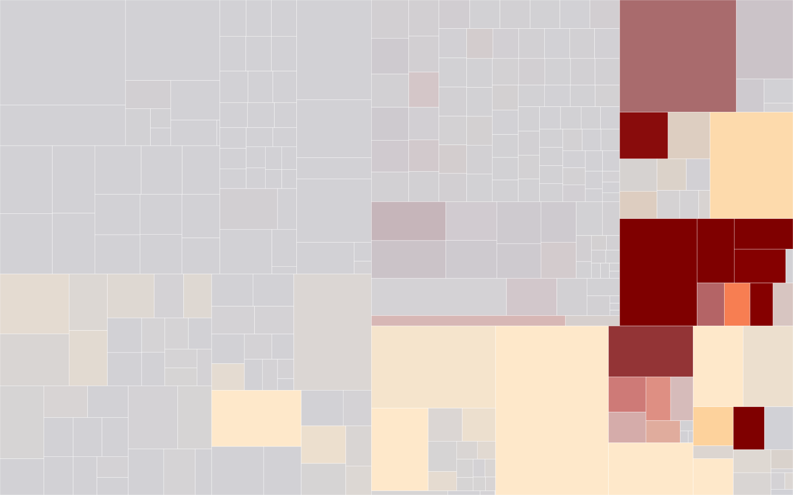
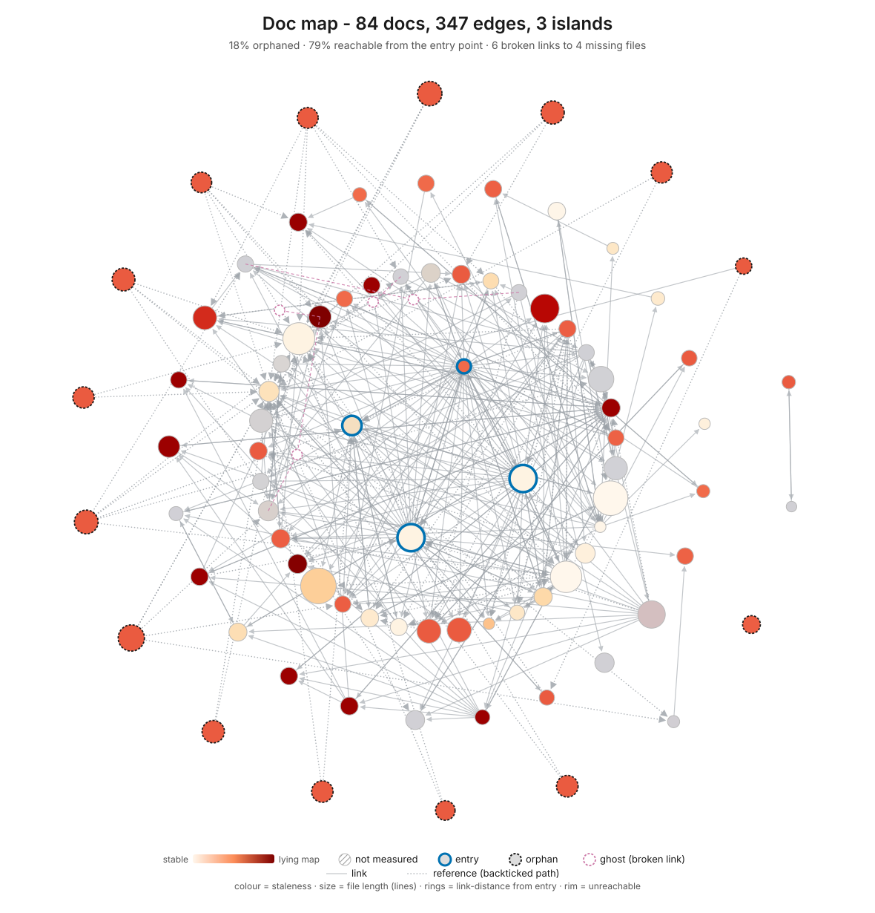

# Codebase Assessment: claude-desktop-debian

_Generated 2026-11-17. Generated by `/assess` v1.100.1._

**Score: 3.0 / 8 - Basic** - a readiness snapshot, not a verdict · Keyhole: 5 structural concerns (3 hidden coupling, 1 lying map, 1 unactioned intent), 0 safe zones.

This repo writes down what it learns: `CLAUDE.md` points contributors at a curated `docs/learnings/` tree, and BATS convention suites such as `tests/workflow-runner-pin.bats` and `tests/patch-anchors.bats` run in CI to check that workflow pins and asar patch anchors still match the shipped bundle. Most packaging repos never get that far. The gap is on the gate side: no coverage is measured, no bot reviews PRs, and `CLAUDE.md` and `AGENTS.md` are separate 36 KB near-copies that will drift. The most useful next step is to cut them down to one short file that names the exact check command.

_Note: Mutation testing was not run. Layer 6 (Coverage) is capped at Partial and truth-pressure remains unproven._

> **Agents start here.** The prioritized Top 3 actions below are also machine-readable in `.assess/actions.json` (schema v2: every entry carries `rank`, `action`, `done_when`, and `scope_fence`, plus the lifecycle fields `status` / `claimed_by` / `completed_sha` and a derived execution `mode`). Read that file to pick up the work - even with a smaller model - without parsing this report's prose.

## Top 3 Actions

Action 1 clears the one prescribed attention path (`scripts/cowork-fallback/cowork-vm-service.js`), Action 2 measures coverage on the top three hotspots, and Action 3 closes the Layer 0 and Layer 5 instruction-file gap.

| # | Action | Layer | Effort | Command / First Step | Done when | Scope fence | Hotspot files this addresses | Issue |
|---|--------|-------|--------|---------------------|-----------|-------------|------------------------------|-------|
| 1 | Clear the stale marker in `scripts/cowork-fallback/cowork-vm-service.js:1663`: fix it, ticket it, or delete the marker. The comment ("Detect and remove before mkdir") describes the #342 fix that already ships below it, so the cheapest fix is to reword it as a description | 8 | small | Edit line 1663 to read e.g. `// Fix #342: a self-referential .mcpb-cache symlink is detected and unlinked here so the bind mount works.` | A re-run of `/assess` lists no `unactioned_intent` path for this file | Only the comment at line 1663; no logic changes in `startVM` or the bwrap backend | `scripts/cowork-fallback/cowork-vm-service.js` | #979 |
| 2 | Produce a line-coverage report in CI and read it for the top hotspots first: no report exists, so nobody knows how well tests cover the riskiest files | 6 | medium | Wrap the bats run in `.github/workflows/tests.yml` with `kcov` (shell) and enable `c8` for `scripts/cowork-fallback/tests/` (JS); upload `coverage.xml` / `lcov.info` as an artifact | CI emits a Cobertura or LCOV file, and a re-run of `/assess` reports `coverage_report.available: true` | Measure only; no coverage threshold yet, and no new tests in this change | `scripts/launcher-common.sh`, `scripts/cowork-fallback/cowork-vm-service.js`, `tests/test-artifact-common.sh` | #980 |
| 3 | Make `CLAUDE.md` the single instruction file. Replace `AGENTS.md` with a symlink or one-line stub pointing at it, cut `CLAUDE.md` toward 200 lines (drop the directory tree and overview, move topic guidance into `.claude/skills/`), and add the exact check commands | 0, 5 | medium | Add to `CLAUDE.md`: `bats tests/*.bats scripts/cowork-fallback/tests/*.bats` and `git ls-files -- '*.sh' \| xargs shellcheck -x`; commit a lockfile for `tools/test-harness/package.json` | `AGENTS.md` is under 32 KiB (no Codex truncation); a re-run reports `layer5_cap.applies: false` and no `claude_shadows_agents` finding | Instruction files and the harness lockfile only; no script or workflow changes | - | #981 |

`attention_low_signal` is true: no attention row scores above 1, so the ranking separates nothing and only rank 1 is prescribed. Slots 2 and 3 come from the gap list and the scorecard.

### Why these three?

Action 1 costs one line and removes the only prescribed signal. The marker is a description, not an open promise, so leaving it means every later run will keep flagging a "promise" that was kept long ago. Action 2 targets the scorecard's largest blind spot: `scripts/launcher-common.sh` has 100 commits in the last 12 months, aggregate ccn 208, and no per-function analyser for shell, and nothing records which of its branches the bats suites reach. Action 3 fixes two problems at once. Claude Code reads only `CLAUDE.md`, so edits to `AGENTS.md` never reach it, while `AGENTS.md` (36,119 bytes) already exceeds Codex's 32 KiB budget and gets truncated. Naming the check command also lifts the Layer 5 cap.

## Snapshots

### Complexity - riskiest to change

The risk concentrates in shell (`scripts/launcher-common.sh`, `build.sh`, `scripts/packaging/*.sh`), where no per-function figure exists. In the measured JS/TS, per-function ccn p95 is 11, with the worst function `startVM` at 31.

### Doc navigability - can an agent find its way?

79% of the 84 docs can be reached from an entry point by following links. The gap is mostly the unlinked `docs/reports/` dossiers plus 6 links still pointing at scripts that moved, and one hand-written README trails its code by 14 commits.

📈 Snapshot detail (commit, hotspots, navigability, lying maps)

#### Complexity profile

- **Measured at commit:** `3dda789715bb` (2026-11-17)
- **Files scored:** 283 (107 lizard, 176 scc)
- **Churn window chosen:** last 12mo
- **Complexity profile:** per-function ccn p95 11 (max 31); file-aggregate ccn p95 50 (max 635); p95 est. tokens 9,919 (max 42,444; code 42,444, data 29,272); p95 NLOC 497 (max 4,962; code 2,256, data 4,962)
- **Top hotspots** (composite `sqrt(effective_ccn) × sqrt(1 + commits) × sqrt(est_tokens)`; `ccn` is the file aggregate, the worst single function in parentheses):
  1. `scripts/launcher-common.sh` - 18,442 est. tokens (1,229 NLOC), aggregate ccn 208, 100 commits in window
  2. `scripts/cowork-fallback/cowork-vm-service.js` - 29,110 est. tokens (2,256 NLOC), aggregate ccn 635 (worst function `startVM` 31), 15 commits in window
  3. `tests/test-artifact-common.sh` - 9,576 est. tokens (581 NLOC), aggregate ccn 103, 23 commits in window
  4. `build.sh` - 2,964 est. tokens (239 NLOC), aggregate ccn 52, 121 commits in window
  5. `scripts/packaging/deb.sh` - 5,310 est. tokens (291 NLOC), aggregate ccn 77, 39 commits in window
- **Size units:** `loc` and every `LOC` label is NLOC (blank and comment lines excluded); physical line counts (`wc -l`) run higher.
- **Per-function coverage:** no per-function data for BASH, Shell, Nix (scored at file level only).
- **Keyhole budget:** the repo is about 872k est. tokens. 1 subtree exceeds the ~200k keyhole budget: `docs` (~408k), driven by the JSON and markdown under `docs/reports/`. No single file exceeds it.

Size encodes estimated tokens, colour encodes cyclomatic complexity (dark red = high), and saturation encodes recent git churn (vivid = active).

No hatching visible - mutation analysis was not run. The hatching would mark covered-but-unpinned code (tests that execute without constraining). Run `/assess` and accept the mutation offer to enable it.

#### Where to focus testing

Coverage data: none found - test signals are heuristic-only.

Coverage gate: none detected

| File | Risk | Test Signal | Suggested Action |
|------|------|-------------|------------------|
| `scripts/launcher-common.sh` | High | Unsupported (no report; no sibling or parallel-tree test found) | Measure coverage |
| `scripts/cowork-fallback/cowork-vm-service.js` | High | Unsupported (no report; no sibling or parallel-tree test found) | Measure coverage |
| `tests/test-artifact-common.sh` | High | Unsupported (no report; no sibling or parallel-tree test found) | Measure coverage |
| `build.sh` | Medium | Unsupported (no report; no sibling or parallel-tree test found) | Measure coverage |
| `scripts/packaging/deb.sh` | Medium | Unsupported (no report; no sibling or parallel-tree test found) | Measure coverage |
| `scripts/patches/app-asar.sh` | Medium | Unsupported (no report; no sibling or parallel-tree test found) | Measure coverage |
| `scripts/packaging/rpm.sh` | Medium | Unsupported (no report; no sibling or parallel-tree test found) | Measure coverage |
| `scripts/doctor.sh` | Low | Unsupported (no report; no sibling or parallel-tree test found) | Measure coverage |
| `scripts/packaging/appimage.sh` | Low | Unsupported (no report; no sibling or parallel-tree test found) | Measure coverage |
| `scripts/setup/detect-host.sh` | Low | Unsupported (no report; no sibling or parallel-tree test found) | Measure coverage |

#### Doc navigability

Of 84 docs, 79% can be reached from an entry point (`README.md`, `CLAUDE.md`, `AGENTS.md`, `docs/index.md`) by following links. The other 18% are **orphans**, meaning nothing links to or cites them, and they sit in 3 disconnected **islands**. Most are dossiers under `docs/reports/CDL-ANT-0009_patch-suite-history/dossiers/` (e.g. `asar-guards.md`, `claude-code.md`, `cowork.md`). All of the reachability comes from markdown links; backticked paths add nothing (link-only reachability is also 79%). This is a curation gap, not hidden content: an agent can still open those files by path. A report index that links the dossiers would close most of it.

**Broken links:** 6, almost all left behind when scripts moved. `docs/learnings/cowork-vm-daemon.md` and `docs/learnings/plugin-install.md` point at `../../scripts/cowork-vm-service.js`, which now lives at `scripts/cowork-fallback/cowork-vm-service.js`. `docs/learnings/test-harness-electron-hooks.md` points at `../../scripts/frame-fix-wrapper.js`. Two docs link to a `docs/learnings/linux-topbar-shim.md` that does not exist.

**Lying maps.** A doc is **stale** when its content has not changed in a while, and it lies when the code it describes (its **subject**) has changed since. One doc has a precise subject and clearly fits: `scripts/cowork-fallback/README.md` was last changed 133 days ago, and its subject code (the 3 files under `scripts/cowork-fallback/`) has taken 14 commits since then (ratio 9, high confidence). The high-centrality hubs that score highest on the raw composite (`docs/testing/matrix.md`, 196 days; `docs/learnings/plugin-install.md`, 211 days) use the whole repo's churn as their subject (`repo-baseline`, low confidence), so they are not flagged as lying maps. Read them against the code before trusting them.

The SVG encodes staleness as colour (vivid red = a frozen doc beside churning code), reachability as structure (centre = entry, rim = unreachable, dashed ring = orphan, solid edge = link, dotted edge = reference), and file length as size.

#### What changed since last run

_No prior run to compare against - this is the first recorded snapshot._

📊 Full scorecard (per-layer evidence & gaps)

The two headline metrics measure **different things and are never combined.** The 0-8 score answers _"is the scaffolding in place to catch problems?"_. The Keyhole Readiness summary answers _"where is today's structural pain?"_.

| Layer | What it asks | Band | Status | Evidence | Gap |
|-------|--------------|------|--------|----------|-----|
| 0: Agent Instructions & Navigability | Can I build a true map of this codebase before I touch it? | read | Partial | `CLAUDE.md` and `AGENTS.md` both exist, each grading B (about 518 lines). `CLAUDE.md` sends contributors to `docs/learnings/`. Skills exist (e.g. `.claude/skills/lint/SKILL.md`). Doc graph: 79% reachable, 18% orphans, 3 islands. `docs/learnings/cowork-vm-daemon.md` links to `../../scripts/cowork-vm-service.js`, which no longer exists. `claude_config` found no ignored keys. | The two instruction files are separate copies: Claude Code never reads `AGENTS.md`, and Codex truncates it (36,119 B > 32 KiB). 6 dangling links. Personal settings are committed in `.claude/settings.local.json`. |
| 1: Runtime Legibility / Liveness | Can I see which parts are live, which need attention, and which are dead weight? | read | Missing | Observability rung 0: no `OBSERVABILITY.md`, no `.mcp.json`. vulture found no dead code in the Python. There is no deployed runtime, so liveness is read through complexity, churn and reachability, not telemetry. | Shell, the bulk of the code, has no reachability analyser. A runbook doc saying where the packaged app writes its logs, and how to read them, would reach rung 2. |
| 2: Code Design | Will the type-checker catch my mistakes? | write | Partial | `tools/test-harness/tsconfig.json` sets `"strict": true`. | The shipped code (`build.sh`, `scripts/*.sh`) is bash, with no type checking. |
| 3: Linters | Are complexity and style bounds enforced, or will my code drift? | write | Partial | `.github/workflows/shellcheck.yml` runs `xargs shellcheck -x` on every tracked `.sh`. Per-function ccn p95 is 11 (max 31). | No complexity or length rules. `CLAUDE.md` names `actionlint`, but no workflow in `.github/workflows` runs it. |
| 4: Architecture Tests | Are the structural conventions executable, or just folklore? | write | Partial | `tests/workflow-runner-pin.bats`, `tests/workflow-node-floor.bats` and `tests/patch-anchors.bats` encode conventions, and `.github/workflows/tests.yml` runs `tests/*.bats`. | Nothing enforces module boundaries or file and function size, and there is no ratchet. |
| 5: CI Pipeline | Does something automatically catch a bad change before it merges? | write | Partial | `.github/workflows/tests.yml` runs `bats --print-output-on-failure` on `pull_request`. The slowest CI median is 7.7 min, under the 10-min guidance. | Capped at Partial: no instruction file names a check command, and `tools/test-harness/package.json` has no lockfile (no `tools/test-harness/package-lock.json`). |
| 6: Coverage Gates | Do the tests constrain behaviour, or just execute lines? | write | Missing | No workflow in `.github/workflows` mentions coverage, and there is no `codecov.yml`. Mutation testing did not run. | No coverage report and no gate. |
| 7: Code Review Bots | Is there design-level feedback on every change? | write | Missing | No `.coderabbit.yaml`, and no review bot is referenced in `.github/workflows`. Of 30 merged PRs, 57% had a review and 50% were self-merged. | No automated PR review. |
| 8: AI Project Mgmt (capstone) | Do learnings feed back into the contracts, or evaporate? | meta | Partial | Committed agents (`.claude/agents/issue-triage.md`), hooks (`.claude/hooks/session-start.sh`), and a Claude issue-triage pipeline (`.github/workflows/issue-triage-v2.yml` loads `.claude/scripts/prompts/classify.txt`). Learnings are fed back via `docs/learnings/`. | No shared `.claude/settings.json` permission allowlist, and no structured task orchestration. |

### Score derivation (worked)

0 Present + 6 Partial (L0, L2, L3, L4, L5, L8) + 3 Missing (L1, L6, L7): raw sum = 6 × 0.5 = **3.0**, under the cap of 8, so the display is **3.0 / 8**. That is 0.375 of the maximum, exactly on the Basic threshold. (The layer scorer's draft headline said 3.5; it did not match its own verdicts and was corrected here.)

### Maturity Level

| Score | Level | Description |
|-------|-------|-------------|
| 0-2 | Not Ready | Agent will produce inconsistent, unvalidated code |
| 3-4 | Basic | Norms exist but aren't enforced. Agent works but drifts |
| 5-6 | Solid | Contracts catch most issues. Agent is productive |
| 7-8 | AI-Native | System self-improves. Agents work reliably at scale |

### What this score unlocks

Basic bounds the repo at the Step 1-2 boundary of the adoption ladder ([Steps of AI Adoption](https://www.threads.com/@boris_cherny/post/Da4CkQnEea-), B. Cherny, 2026): running agents in parallel is risky until Layer 5 and Layer 6 self-verification holds. This is a bound, not a claim about how the team works.

🔎 Cross-layer findings & lying signals (keyhole detail)

### Lying Signals

No row qualifies. The top stale hub (`docs/testing/matrix.md`) has low confidence, because its subject is the whole repo. No instruction-claim failures, no ignored Claude Code config, no dead-code candidates, no config drift, and no mutation data. The review-rule flags could not be read.

### Agent harness

No committed hooks, env, apiKeyHelper or MCP servers run from shared settings.

- `.claude/settings.local.json` - personal settings file is committed (`tracked_local_settings`). Fix: `git rm --cached .claude/settings.local.json` and gitignore it, then commit shared settings in `.claude/settings.json`.

### Agent environment

- **Setup:** none committed
- **Check:** no instruction file names a check command; `package.json` exposes `npm run test`
- **Pinning:** `tools/test-harness/package.json` is not locked
- **CI duration:** slowest median 7.7 min (`CI`) on `main` over 34 runs, under the 10-minute guidance
- Layer 5 capped at Partial: no instruction file names a check command that resolves; no committed setup and no lockfile for `tools/test-harness/package.json`

## Cross-Layer Findings (Keyhole Readiness)

Each finding has a score of 1, so treat this list as pointers, not a ranking. The `unactioned_intent` hit at `scripts/cowork-fallback/cowork-vm-service.js:1663` is a comment describing the shipped #342 fix, not an open promise. The `hidden_coupling` directories (`.claude/scripts`, `.claude/scripts/triage`, `docs`) change together with the issue-triage workflow, which is expected for a prompt-plus-schema pipeline.

### hidden_coupling

Action: investigate the seam

Paths:
- .claude/scripts
- .claude/scripts/triage
- docs

### lying_map

Action: fix or delete the doc

Paths:
- scripts/cowork-fallback/README.md

### unactioned_intent

Action: action the promise: fix it, ticket it, or delete the marker/skip (stale: an untracked marker that survived 5 or more edits to its own file)

Paths:
- scripts/cowork-fallback/cowork-vm-service.js

### Attention List (Priority Order)

- scripts/cowork-fallback/cowork-vm-service.js (score 1): unactioned_intent
- .claude/scripts/triage (score 1): hidden_coupling
- .claude/scripts (score 1): hidden_coupling
- docs (score 1): hidden_coupling
- scripts/cowork-fallback/README.md (score 1): lying_map

✅ Strengths & further opportunities

### Strengths

- `docs/learnings/` is a curated record of what went wrong, and `CLAUDE.md` tells contributors to add entries, so learnings are written down rather than lost.
- BATS convention tests (`tests/workflow-runner-pin.bats`, `tests/workflow-node-floor.bats`, `tests/patch-anchors.bats`) turn CI and patching rules into executable checks on every PR.
- `.github/workflows/shellcheck.yml` lints every tracked `.sh`, sourced scripts included.
- A Claude-driven issue-triage pipeline (`.github/workflows/issue-triage-v2.yml` with prompts under `.claude/scripts/`) puts agent work in version control.
- CI is fast: the slowest workflow's median is under 8 minutes.

### Additional Opportunities

- Untrack `.claude/settings.local.json` and move its 3 shared hook events into `.claude/settings.json`.
- Run `actionlint` in CI, since `CLAUDE.md` already asks for it before every push.
- Fix the 6 dangling links in `docs/learnings/` and `docs/testing/cases/` (most point at `scripts/cowork-vm-service.js`, now `scripts/cowork-fallback/cowork-vm-service.js`).
- Refresh `scripts/cowork-fallback/README.md` against the 14 commits its subject has taken since it last changed.
- Add a report index that links the `docs/reports/CDL-ANT-0009_patch-suite-history/dossiers/` orphans.
- Add a short runbook saying where the packaged app writes its logs (Layer 1, rung 2).
- Add an automated PR review bot (Layer 7).

🧭 How to read this report (framing & method)

**What this is ultimately measuring.** When you hand work to an AI here, does it behave like a brand-new hire or like an engineer who has been in the org eighteen months? The difference isn't capability - it's *externalized context*: knowing where things live, which contracts other code relies on, where the minefields are. An AI contributor is structurally always the new hire - it starts every session with an empty head, seeing one narrow slice through its context window - so this report scores how much of the tenured engineer's implicit map the codebase has made explicit and navigable. The aim is not an AI that comprehends what humans no longer can and is trusted blindly (that is the dangerous case); it is a codebase legible enough that the relevant slice fits one context window and the agent's answers stay anchored to code you can still verify. **Legibility you can trust, not omniscience you can't.** The same ethic points at the write side: when a contributor makes a mistake, the useful question is what made it possible and what would make it impossible next time - so the write-side layers below (linters, architecture tests, CI gates, coverage, review automation) read not as a leash on the agent but as the guardrails that protect any contributor, human or AI, from costly mistakes by design. A **Missing** there means the codebase asks the contributor to be careful where it could instead make the wrong move hard to make.

This is an improvement roadmap, not a verdict. It measures one thing: **is the codebase kept honest, not just scaffolded.** It pairs three views:

- **Where the codebase is today** - the complexity heatmap shows current complexity and churn. Vivid red = complex AND actively changing = the files most likely to bite an agent (or a human) next week.
- **Whether an agent can navigate it** - the doc graph shows the docs' link structure: how much is reachable from the entry point, and which docs are stale maps of churning code.
- **What keeps it from getting worse** - the AI Readiness score (0-8) across three bands: read-side foundation (can the agent form a true picture?), write-side enforcement (can it be trusted to produce good output?), and meta (does the system keep itself honest over time?).

A codebase can be 8/8 and still on fire (great scaffolding, legacy debt) - or 2/8 with a calm treemap (small codebase, no enforcement needed yet). The views matter together.

**Each layer is a sense the agent needs, not a box to tick - and this report is written to be understood without prior knowledge of the framework.** Every row in the scorecard names one thing an agent (or a newly-arrived human) must be able to *see or trust* before working safely here; it's phrased as the question that row answers. A **Missing** or **Partial** is not a mark against the codebase - it locates where someone working here is partly blind, and the Gap column says what would restore the view. One row matters most for cold readers, because it's the one most often misread: **Layer 1 (Runtime Legibility) is the agent's attention-sense - "which parts are actually live, which need attention, which are dead weight creating support burden?"** A running service answers that through telemetry (latency, errors, traffic); a repo with no deployed runtime answers it through complexity, churn, and reachability - so the complexity heatmap and the dead-code scan *are* its observability. A low telemetry score on such a repo means *look through those instruments instead*, *not* "the agent is flying blind." Observability, in this report, is whatever lets the agent see where to point effort - by whichever instrument fits the codebase.

**The legacy-transition lens - this is not a new problem.** The hard part of AI-assisted coding is the same one the industry has faced for 25 years: *what happens when the people who understood the code are gone, or the code outruns anyone's ability to understand it?* AI only changes the **velocity** - a codebase can now slide from modern to legacy in months rather than years, because agents can generate change faster than a team can keep comprehending it. So read this report through the accumulated discipline of legacy-code engineering, not as a novel AI concern. The grounded references below are deliberate: a reading agent already knows them, and they carry weight that "we think you should add tests" does not.

- **"Legacy code is code without tests."** - Michael Feathers, *Working Effectively with Legacy Code* (2004). A file that is **complex, churning, and untested is already legacy**, regardless of its age. The correct response is to write **characterization tests** (pin the code's *actual current behaviour*, since that is what callers depend on - not its intended spec) and find a **seam** (a place to change behaviour without editing the code) to get it under test, *then* refactor.
- **Don't rewrite - strangle.** The instinct under AI velocity is to throw a confusing module away and regenerate it. That is the oldest trap in the book (Joel Spolsky, *Things You Should Never Do*, 2000): a rewrite discards the undocumented behaviour and bug-fixes a working system has accreted. Prefer Martin Fowler's **Strangler Fig** - replace incrementally around the edges, behind tests. An agent's default ("regenerate from intent") is precisely the wrong move; say so where a hotspot invites it.
- **Hotspots and change-coupling are the map.** The complexity-×-churn heatmap and the coupling findings in this report *are* Adam Tornhill's (CodeScene) hotspot and change-coupling analyses - the modern, version-control-aware form of legacy comprehension. Treat the vivid-red hotspots and the `hidden_coupling` seams as the prioritized worklist, not trivia.
- **Decide per component (the 7 Rs).** Not every flagged unit should be refactored: retain, retire, rehost, replatform, refactor, re-architect, or rebuild. Dead weight → *retire*; complex-and-live → *characterize then refactor*; safe `refactor_boundary` zones → hand to an agent in isolation.

When you write the findings and Top 3 Actions, name these anchors where they apply - they tell a reading agent *how to think* about the situation, not just what the metric says.

**How it's measured.** This is an AI-readiness review run almost entirely on *traditional* tooling - static analysis, git history, and graph metrics over the docs and code. The model only writes the prose around those numbers; it does no scanning itself. That keeps a full run fast and close to zero in model tokens, and makes the structural findings reproducible run-to-run.

🤖 Machine-readable data (for agents)

If you are an agent working in this repo, the `.assess/` directory is actionable feedback written for you - the first place to look when deciding where to point effort. It is a compounding, AI-readable record that an agent can ingest directly, without re-parsing this prose, and it grows with every run:

- `.assess/assess-report.md` - this report: the scorecard, the lying signals, and the Top 3 Actions with exact commands and file paths.
- `.assess/run-context.json` - the full data bus (findings, attention, keyhole summary, prescribed actions, stats, diff).
- `.assess/complexity-stats.json` - complexity / estimated-token / LOC percentiles, the keyhole-budget rollup (`est_tokens.budget`), plus the ranked file lists (`top_hotspots`, `top_complex`, `top_large`).
- `.assess/hotspots/<file>.md` - per-file briefings, each with a **Suggested actions** section. Read a file's briefing before you change it.
- `.assess/index.md` - the catalog of every hotspot ever flagged (current and graduated), so you can see what has and hasn't been addressed.
- `.assess/log.md` - append-only run history, so a hotspot's trajectory (regressing / persistent / improving) is visible across runs.

---

_Report generated by [`/ai-native-toolkit:assess`](https://github.com/bjcoombs/ai-native-toolkit). Install in any Claude Code session: `/plugin marketplace add https://github.com/bjcoombs/ai-native-toolkit` then `/plugin install ai-native-toolkit@ai-native-toolkit`._
